<p align="center">
  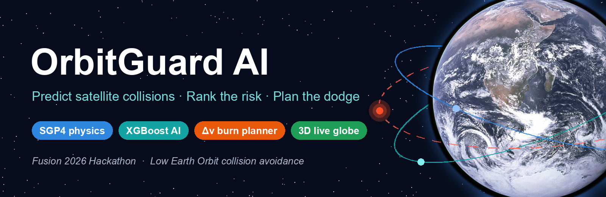
</p>

<p align="center">
  
  
  
  
  
  
</p>

<p align="center">
  <b>OrbitGuard AI</b> watches every satellite and debris piece in Low Earth Orbit, warns about close approaches up to 7 days ahead,<br>
  uses AI to rank the dangerous ones first, and suggests the <b>smallest engine burn</b> that dodges them safely.
</p>

<p align="center">
  <a href="#-the-problem">Problem</a> •
  <a href="#-our-solution">Solution</a> •
  <a href="#-project-output">Output</a> •
  <a href="#-how-it-works--full-workflow">Workflow</a> •
  <a href="#-results">Results</a> •
  <a href="#-technologies">Tech</a> •
  <a href="#-datasets">Datasets</a> •
  <a href="#-run-it-yourself">Run it</a>
</p>

---

## The problem

> **Problem statement (Fusion 2026):** Low Earth Orbit is increasingly congested. Warnings of near-collisions between satellites and debris are growing faster than ground teams can check each one by hand.
> **Expected solution:** using public TLE orbit data, build a system that **predicts upcoming close approaches**, **ranks them by collision probability**, and **recommends an avoidance manoeuvre** (timing + Δv direction) for at least one event.

<table>
  <tr>
    <td width="50%">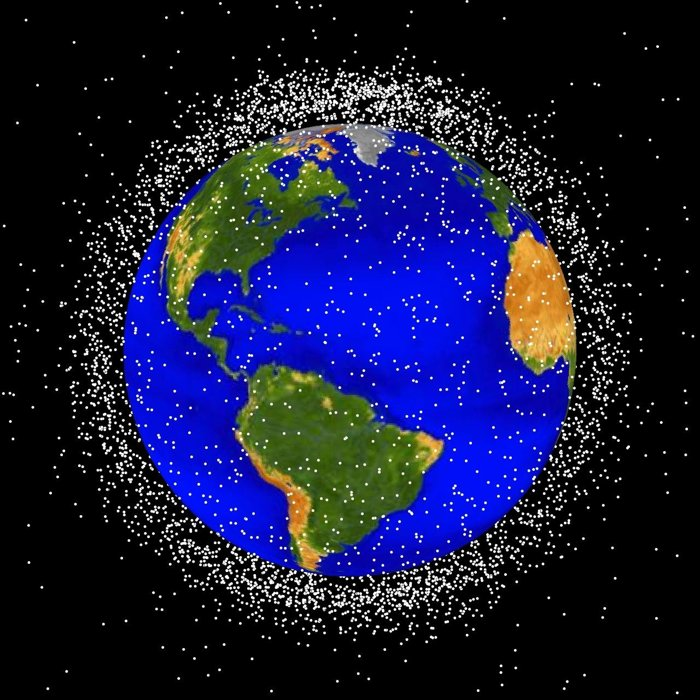</td>
    <td width="50%">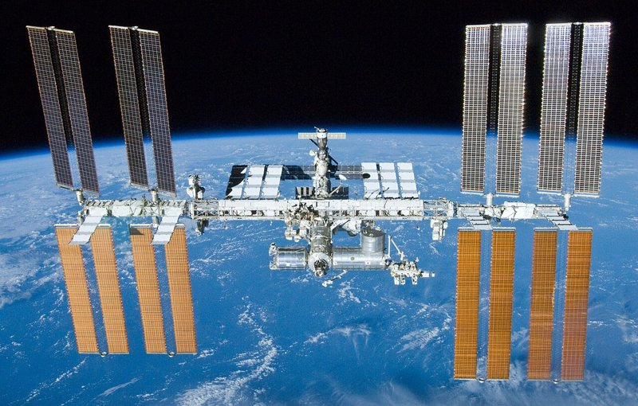</td>
  </tr>
  <tr>
    <td align="center"><sub>Thousands of tracked objects crowd Low Earth Orbit. <i>Image: NASA Orbital Debris Program Office</i></sub></td>
    <td align="center"><sub>Even the ISS regularly has to manoeuvre to dodge debris. <i>Image: NASA</i></sub></td>
  </tr>
</table>

**Why it matters, in our own numbers** (one 7-day screening of live data, 10–16 Oct 2026):

| Objects tracked | Close approaches (< 5 km) in 7 days | Critical events |
|:---:|:---:|:---:|
| **18,550** | **118,318** | **1,661** |
| satellites + debris in LEO | far too many to check by hand | need a decision **now** |

---

## Our solution

One automatic pipeline, from **free public orbit data** to a **safe, checked avoidance burn**:

| Step | What it does |
|---|---|
| **1. Track** | Downloads the latest orbits of every LEO satellite and 4 debris clouds from CelesTrak |
| **2. Predict** | Uses orbit physics (SGP4) to find **every close approach in the next 7 days**, with the exact time, miss distance and collision probability |
| **3. Rank** | An **AI model (XGBoost)** trained on real ESA collision warnings ranks events so the most dangerous come first |
| **4. Avoid** | Plans the **smallest burn** (when, which direction, how strong) that makes the event safe, plus a burn to return to the original orbit |
| **5. Verify** | Re-checks the new path against **all 18,550 objects**, so the dodge doesn't create a new near-miss |
| **See it** | Everything is shown live on an **interactive 3D globe** in the browser |

It answers the two questions an operator has:

- **Which close approach matters most?** → an AI-ranked list, most urgent first
- **Which burn makes it safe?** → burn time + direction + size, already safety-checked

---

## Project output

### 1. Live 3D globe, debris alert and AI-ranked list
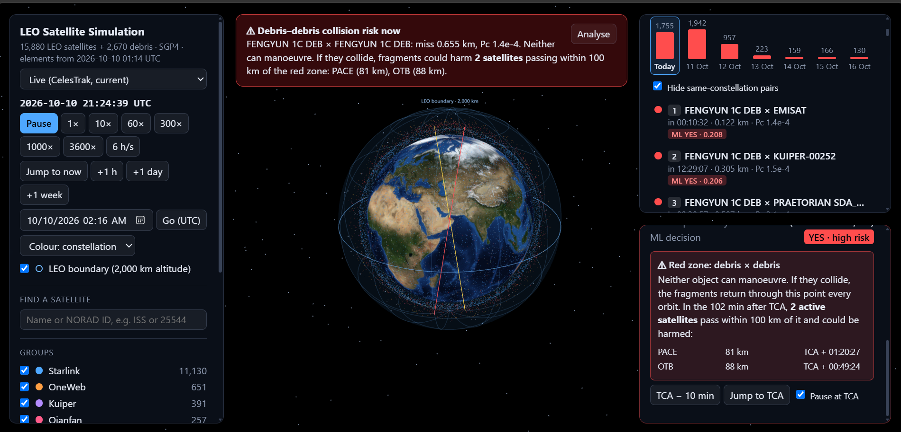

- **Center:** the Earth with all **18,550** tracked objects moving in real time. The yellow and red lines are the orbits of the two objects being analysed.
- **Top banner:** a **debris-vs-debris** warning. Two dead objects may collide, and the app names the active satellites that would fly through the fragments.
- **Right:** **events per day** for the next 7 days, plus the conjunction list **ranked by the AI** (`ML YES · 0.208`).
- **Bottom right:** the **red zone** card, listing which satellites pass within 100 km of the predicted crash point, and when.

### 2. Analysing a close approach and planning the dodge
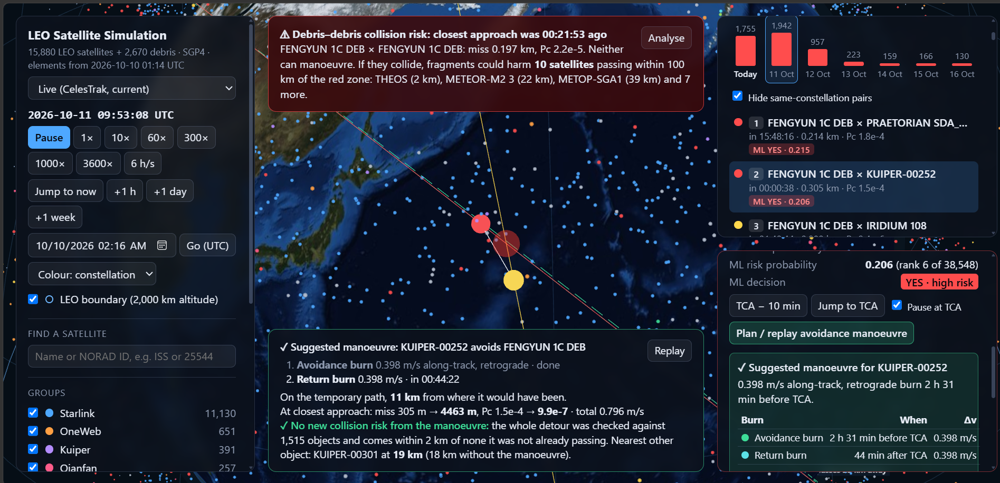

- **KUIPER-00252** is predicted to pass **305 m** from a FENGYUN 1C debris piece. The AI ranks it **6th of 38,548** (YES, high risk).
- **Suggested manoeuvre:** a **0.398 m/s** retrograde burn **2 h 31 min before** the encounter, then a return burn 44 min after.
- **Result:** miss distance **305 m → 4,463 m**, collision probability **1.5e-4 → 9.9e-7**.
- **No new risk:** the whole detour was checked against 1,515 nearby objects.

### 3. The avoidance path in 3D
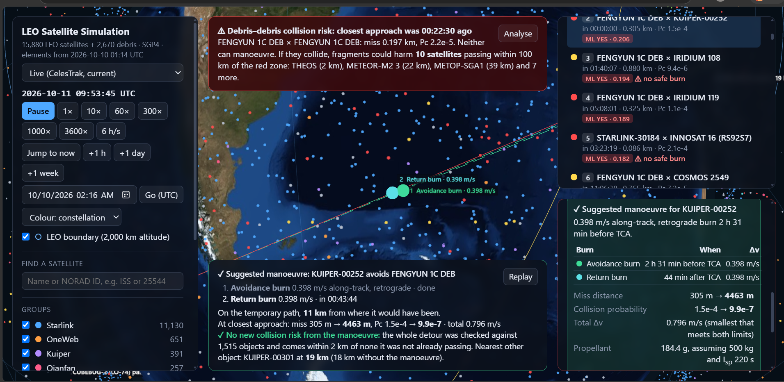

- The **green dashed line** is the temporary detour, with markers for **① the avoidance burn** and **② the return burn**.
- The card shows the full plan: burns, Δv, miss distance before/after, and **propellant used (184 g** for a 500 kg satellite).

<details>
<summary><b>More: full app screenshot</b></summary>
<br>
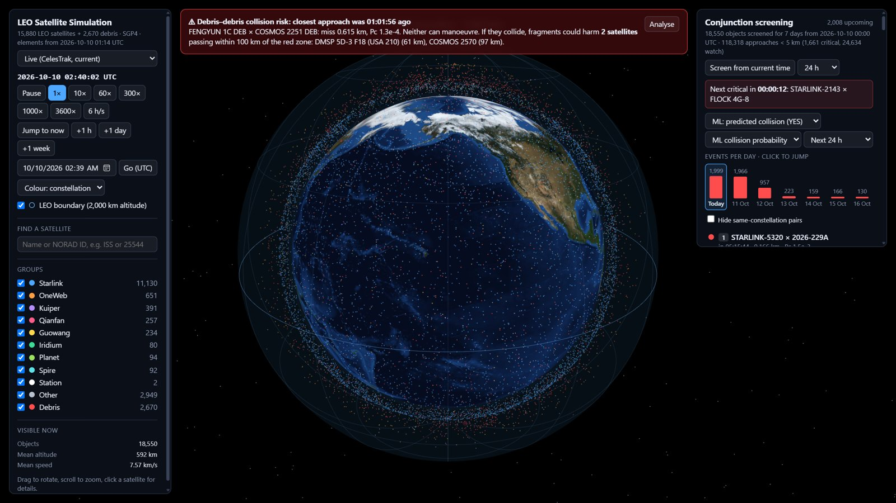

Left: time controls (pause up to 6 h per second, +1 h / day / week, date picker), colour by constellation, search. Right: 7-day screening summary, AI filter and events-per-day chart.
</details>

---

## How it works – full workflow

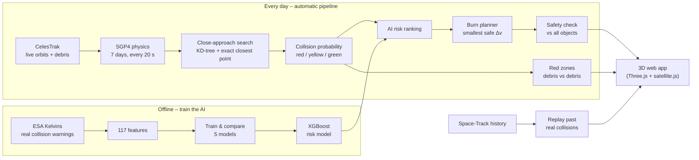

### Step by step

**1. Track – get the orbits**

`src/fetch_positions.py` downloads orbital elements (OMM/TLE) for all active satellites and 4 debris clouds (COSMOS 2251, Fengyun-1C, Iridium 33, Cosmos 1408) from **CelesTrak**, and keeps only objects in LEO (below 2,000 km).

**2. Predict – find every close approach** (`src/screen_conjunctions.py`)
- **SGP4** computes every object's position every **20 seconds** for **7 days**.
- A **KD-tree** (fast neighbour search) only compares objects that are near each other, so we never test all 170 million pairs.
- Each candidate is refined to the exact **time of closest approach (TCA)** and **miss distance**.
- A **collision probability (Pc)** is computed (Foster/Chan 2D method). Risk colours: **critical** = Pc ≥ 1e-4 or miss < 200 m, **watch** = Pc ≥ 1e-5 or miss < 1 km.

**3. Rank – AI decides what matters first** (`ml/`)
- Trained on **ESA's Kelvins Collision Avoidance Challenge** dataset: real Conjunction Data Messages from ESA operations (9,264 training events).
- We compared **Logistic Regression, Random Forest, HistGradientBoosting, LightGBM and XGBoost**. XGBoost was chosen by grouped cross-validation.
- Every live event gets an **AI risk probability**, a **YES/NO** decision and a **rank**.

**4. Avoid – plan the smallest dodge** (`src/maneuver.py`, `ml/avoidance.py`)
- Uses **Clohessy–Wiltshire (Hill) equations**: how a small push changes a satellite's position relative to its normal path.
- Searches burn times from 0.1 to 3 orbits before TCA and many directions, then picks the **cheapest burn** that gives **miss ≥ 1 km and Pc ≤ 1e-6**.
- Adds one or two **return burns** after the encounter, so the satellite goes back to its original orbit.
- Propellant is estimated with the rocket equation (assumed 500 kg satellite, Isp 220 s).

<p align="center">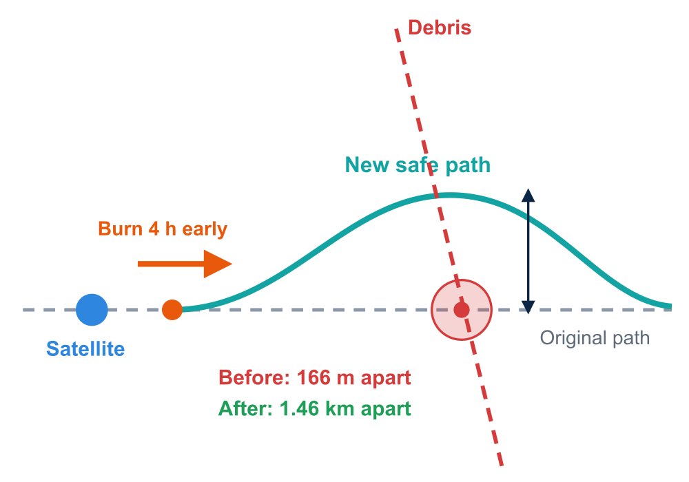</p>

**5. Verify – make sure the dodge is safe**

The whole detour is re-flown and checked against **every object** in its altitude band. If it would create a new approach (< 2 km or Pc ≥ 1e-6), it is rejected and the next-best burn is tried. If no safe burn exists, the event is marked **no safe burn – COLLISION WARNING**.

**6. Red zones – when nobody can move**

Two pieces of debris can't manoeuvre. If they might collide, OrbitGuard draws a **100 km "red zone"** around the predicted crash point and lists every active satellite that flies through it during the next orbit.

<p align="center">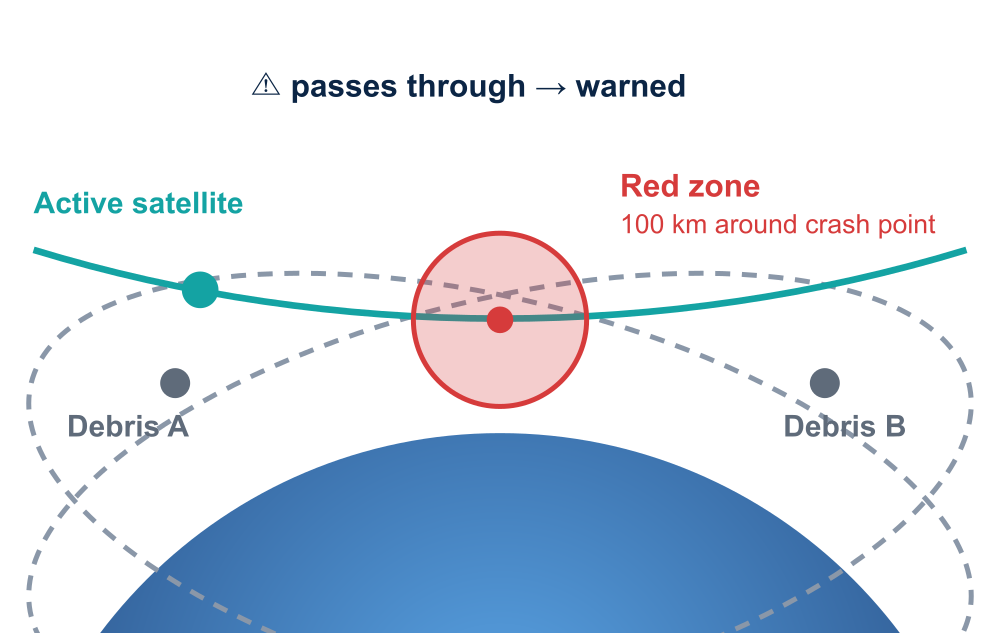</p>

**7. Always up to date**

`src/server.py` checks every 15 minutes and rebuilds the data each new UTC day (fresh orbits → 7-day screening → AI ranking). You can also pick **any date** and the server screens that window on demand.

**8. Proof on history** (`src/history.py`)

We rebuilt the sky using **only data published 24 h before** real past collisions, to test whether OrbitGuard would have warned in time (see results below).

---

## Satellite communication – satellites that dodge on their own

A second simulation (`autonomy/`): instead of a ground team screening the whole catalogue, **satellites talk to each other by radio** and decide among themselves who moves. Open it with the **"Satellite communication"** button in the 3D app.

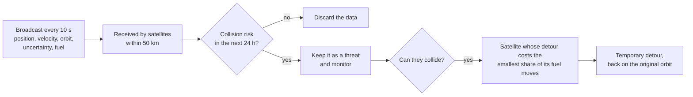

| Step | What happens |
|---|---|
| **1. Broadcast** | Every 10 s each satellite sends its position, velocity, orbit elements, position uncertainty and fuel level |
| **2. Range** | Only satellites within **50 km** receive it (links drawn live in 3D) |
| **3. Keep or discard** | The receiver predicts the next **24 h** on board: no risk → data discarded, risk → kept as a threat |
| **4. Who moves?** | Both satellites hold the same data and apply the same rule, so they agree without more messages. Each one's Δv (from its velocity relative to the encounter), mass and thruster give the propellant it needs; the one for which the detour costs the **smallest share of its remaining fuel** manoeuvres (keeping a 5 % reserve) |
| **5. Detour** | A temporary burn before the encounter, safety-checked, then back on the original orbit |
| **6. Debris** | Debris and rocket bodies have no radio, so they stay with the ground screening |

**Results of a 6 h run on the real sky** (10 Oct 2026, 00:00–06:00 UTC):

| Satellites with radio | Messages exchanged | Discarded on board | Threats found | Avoided by the satellites |
|:---:|:---:|:---:|:---:|:---:|
| **15,874** (+ 2,676 silent objects) | **3,581,156** | **99.98 %** | **91** | **46** (33 monitored, 12 warnings) |

**Real example:** STARLINK-5320 and 2026-229A were heading for a **166 m** pass, warned **2.4 h** ahead. The detour would cost Starlink (electric thruster) **0.25 %** of its fuel against **1.79 %** for the other satellite, so Starlink moves: a **1.5 m/s** detour, miss distance **166 m → 1.77 km**, collision chance **1 in 670 → 1 in 1,000,000**.

**Coverage check:** of 241 critical encounters between radio satellites, the network warned 56 at least 10 minutes ahead; 162 pairs first came within 50 km only during the approach itself (at 7–15 km/s). Satellite-to-satellite avoidance works when two satellites have met on an earlier orbit, and complements the ground screening rather than replacing it.

```bash
python autonomy/engine.py      # simulate the network (6 h window, ~1 min)
autonomy/run.sh                # or: simulate if needed and serve it at http://127.0.0.1:8770/autonomy/
```

<sub>Fuel, mass, thruster and position uncertainty are not in public TLE data, so they are simulated per satellite (e.g. Starlink 300–800 kg with electric thrusters, cubesats 5 kg with cold gas). Details: `autonomy/README.md`.</sub>

---

## Results

### Live 7-day screening (10–16 Oct 2026)

| What | Number |
|---|---:|
| Objects screened | **18,550** |
| Close approaches under 5 km | **118,318** |
| Critical / Watch | **1,661** / **24,634** |
| AI-flagged **YES** (high risk) | **5,600** of 38,548 events |
| Ready **burn plans** | **3,326** (median burn **23 cm/s**) |
| Debris-vs-debris **red zones** | **24** (18 with satellites inside, worst: **194** satellites) |

### Would it have predicted real collisions? Yes.

Using only data from **24 hours before** each event:

| Real collision | Predicted time (UTC) | Miss | Flagged as | Rank |
|---|---|---:|:---:|---|
| **Iridium 33 × Cosmos 2251** (10 Feb 2009), the first satellite-satellite crash | 16:55:59.8 (real: 16:55:59.7–.99) | 584 m | critical | 32 of 5,171 |
| **Cerise × Ariane 1 debris** (24 Jul 1996) | 09:48:02 (date matches) | 1,054 m | watch | 192 of 3,120 |
| **Yunhai 1-02 × Zenit-2 debris** (18 Mar 2021) | 07:41:19 (real: 07:41) | 216 m | watch | 746 of 17,488 |

For Iridium–Cosmos, our prediction matches CelesTrak SOCRATES' own prediction from that day (584 m, 16:55:59.806).

### AI model (ESA held-out test set)

| Model | High-risk events caught (recall) | ROC-AUC |
|---|:---:|:---:|
| Logistic Regression | 51 % | 0.93 |
| HistGradientBoosting | 48 % | 0.96 |
| Random Forest | 67 % | 0.96 |
| LightGBM | 77 % | 0.96 |
| **XGBoost (chosen)** | **77 %** | **0.96** |

<<<<<<< HEAD
A critical conjunction between two debris objects cannot be avoided: neither can manoeuvre. If they
collide, the fragments spread along both orbits and all return through the collision point once per orbit.
The screener therefore turns every critical (red) debris-debris event into a **red zone**: a 100 km sphere
around the predicted collision point. For each zone it lists the active satellites that pass through that
sphere between TCA and one orbital period later (`debris_zones` in `src/screen_conjunctions.py`).

In the simulation the zone is drawn as a red sphere from one hour before TCA until the end of that orbit
(pulsing after TCA). When satellites are exposed, a banner names them; the analysis card lists each one's
closest distance and time, and selecting an exposed satellite shows the warning in its card. The filter
"Debris vs debris red zones" lists all of them.

In the current 7-day run: 26 red zones, 20 with at least one active satellite passing through (up to 194).
Windows screened on demand by `src/server.py` carry their red zones too.
The satellite lists were checked against a 1-second brute-force search of every active object for two zones:
same satellites, distances within 0.34 km. The zone is a simplified indicator, not a fragment-cloud model:
the 100 km radius and the one-orbit window are chosen values, and a predicted close approach is not a collision.

```bash
.venv/bin/python src/screen_conjunctions.py --zones-only   # redo only the zones of the existing app file (~20 s)
```

### Avoidance manoeuvres (satellite vs satellite, satellite vs debris)

When a critical or watch conjunction with at least one satellite is analysed, `src/maneuver.py` plans a
temporary detour for it (served by `src/server.py`, `/api/maneuver`). Debris and rocket bodies cannot
manoeuvre, so debris-debris events get no plan: they stay red zones (above).

- **Who moves:** each object of the pair that can manoeuvre is planned; the one needing less Δv is recommended.
- **Physics:** the detour is the SGP4 path plus an offset propagated with the Clohessy-Wiltshire (Hill)
  equations in the satellite's radial / along-track / cross-track frame. Burns are impulsive.
- **Minimum fuel:** the avoidance burn is the smallest one that gives miss ≥ 1 km and Pc ≤ 1e-6. The offset at
  TCA is linear in the burn, so the cheapest burn that shifts the satellite to a given point of the encounter
  plane is the pseudo-inverse solution; the planner takes the cheapest of these over the edge of the unsafe
  region, for burn times from 0.1 to 2 orbits before TCA in steps of 0.05, and sizes it by bisection.
- **Return:** as soon as the satellite has passed the collision area (first return burn 1 minute after TCA),
  one or two burns put it back on its original orbit within 0.1 orbit (about 10 minutes) of TCA: same
  semi-major axis, no radial or cross-track offset, a few km ahead of or behind its original position. A fast
  return costs only ~0.2-0.3 m/s more than drifting back over ~40 minutes. The last burn is trimmed with
  full two-body dynamics so the restored orbit's semi-major axis is within a metre (a 10 m error would drift
  ~2 km/day from the slot). The avoided object is re-checked along the return, so it cannot swing back
  towards it.
- **Safety:** the whole detour is checked against every object in its altitude band; a plan that creates a new
  approach under 2 km is dropped and the next cheapest is tried.
- **Propellant:** rocket equation for an assumed 500 kg satellite with I<sub>sp</sub> 220 s (TLEs give neither).

In the simulation the detour is a dashed green line from the avoidance burn until it rejoins the original
orbit, with a marker at each burn. It leaves the orbit by a few km at most, so its radial and cross-track
distance from the orbit is drawn enlarged (the factor is shown, and can be switched off); every number in
the card is the true value.

### 7-day look-ahead

The default window is 7 days (`--hours 168`), split into day-long segments screened in parallel (`--workers`).
In the simulation: a per-day chart of events (click a day to jump there), a look-ahead filter
(next 1 h / 6 h / 24 h / 3 days / whole window), and time controls +1 h, +1 day, +1 week, a UTC date picker, and a 6 h/s speed.

Same-constellation pairs of actively managed constellations (Starlink, OneWeb, Kuiper, Qianfan, Guowang, Iridium) are
only screened while both element sets are at most 1.5 days old: they manoeuvre to keep their spacing, which TLEs cannot
predict, and a 7-day run showed their sub-1 km events growing ~10x by day 6 while other pairings stayed flat.
`data/conjunctions_latest.csv` is large for 7 days and is git-ignored.

## Accuracy and verification

All SGP4 paths use the same full-precision OMM elements from CelesTrak (not TLE text, which rounds eccentricity
and B* and moved some fast-decaying debris by up to ~280 m). `app/data/leo_objects.json` stores epochs on whole
milliseconds (satellite.js parses them with a JavaScript Date) with the mean anomaly compensated.

```bash
.venv/bin/python tests/verify_conjunctions.py      # ~1 min, 8 checks
.venv/bin/python tests/verify_browser_sgp4.py      # browser SGP4 vs Python, needs Node.js
.venv/bin/python tests/verify_maneuver.py          # ~2 min: plans re-flown with two-body integration, 5 checks
```

Last results:
=======
### Accuracy checks (`tests/`)
>>>>>>> c8178b43b25948986468327ab5418a819c6db074

| Check | Result |
|---|---|
| Missed events vs a brute-force search every 1 s (3 windows, 3,462 events) | **0 missed, 0 extra** |
| Closest-approach time & distance vs 1 ms sampling | within **0.15 m**, 1 ms |
| Browser (satellite.js) vs Python SGP4, 140,204 states over 7 days | within **0.31 m** |
| Burns re-checked with fuller physics (two-body + J2), 200 burns | **98 %** stay below Pc 1e-6 |

---

## Technologies

| Area | Tools |
|---|---|
| **Language** | Python 3, JavaScript (ES modules) |
| **Orbit physics** | [`sgp4`](https://pypi.org/project/sgp4/) (Python), [`satellite.js`](https://github.com/shashwatak/satellite-js) 6 in a Web Worker (browser) |
| **Number crunching** | NumPy, SciPy (`cKDTree` neighbour search), pandas, multiprocessing |
| **AI / ML** | scikit-learn, **XGBoost**, LightGBM, joblib |
| **Manoeuvre planning** | Clohessy–Wiltshire relative motion, rocket equation, own planner |
| **3D visualisation** | **Three.js** 0.160 (globe, orbits, markers), HTML/CSS |
| **Server** | Python standard-library HTTP server (`src/server.py`): on-demand screening, manoeuvre API, daily auto-update |
| **Monitoring** | Logfire (optional) for live traces of each pipeline run |

---

## Datasets

| Dataset | Used for | Link |
|---|---|---|
| **CelesTrak GP elements** (OMM/TLE): active satellites + COSMOS 2251, Fengyun-1C, Iridium 33, Cosmos 1408 debris | Live orbits of all 18,550 objects | [celestrak.org/NORAD/elements](https://celestrak.org/NORAD/elements/) |
| **ESA Kelvins Collision Avoidance Challenge** (real CDMs, 2015–2019, CC BY 4.0) | Training & testing the AI risk model | [zenodo.org/records/4463683](https://zenodo.org/records/4463683) |
| **Space-Track.org `gp_history`** (free account) | Rebuilding the sky before past collisions | [space-track.org](https://www.space-track.org/) |

---

## Run it yourself

**Requirements:** Linux/macOS (or Git Bash/WSL on Windows), Python 3.11+, a modern browser (Chrome/Edge/Firefox). Node.js only for one optional test.

```bash
git clone https://github.com/shambhuz28/Fusion-hackathon.git
cd Fusion-hackathon

# Full pipeline: download orbits -> positions -> 7-day screening (~4 min) -> start the server
./run.sh

# Or just start the app with the data already in the repo
./run.sh --serve-only
```

<<<<<<< HEAD
`run.sh` starts `src/server.py`, which serves the simulation and screens conjunctions **on demand for any date**:
when the clock leaves the screened window (date picker, +1 day/week, playback), the panel requests
`/api/screen?start=...&hours=24` (or 3/7 days) and shows the result; results are cached in `data/cache/`.
If port 8765 is busy, the next free port is used. The Python scripts also work with plain `python3`
(they re-run themselves with `.venv/bin/python`, see `src/_venv.py`).

### Daily update: always today and the next 6 days

The live data always covers **today 00:00 UTC to 7 days ahead**, and the "Events per day" chart shows today and
the next 6 calendar days by the real date. `src/daily_update.py` downloads fresh elements from CelesTrak
(cached downloads, or the current elements, when CelesTrak refuses), exports them, screens 7 days from today
00:00 UTC and runs the ML ranking (`ml/`, when set up). It builds everything in `app/data/staging/` and moves the
files into `app/data/` only when all steps have succeeded (~15 min on 16 cores).

`src/server.py` runs it by itself: at start-up and every 15 minutes it checks whether the live screening starts
today, and if not (e.g. after midnight UTC) updates it in the background (`GET /api/status` reports progress).
An open page shows "Updating to today's 7 days…" and then "New 7-day screening ready · Reload". Without the
server, the panel says when the screening is not from today; run the update by hand:

```bash
python src/daily_update.py            # nothing to do if the screening already starts today
python src/daily_update.py --force    # rebuild anyway (--no-download, --no-ml, --days N)
python src/server.py --no-daily-update   # serve without the automatic refresh
```

Days the loaded screening does not cover are drawn grey ("not screened yet"); a history replay, or another week
screened on demand and being viewed, shows its own days.

### Validity of the orbital data
=======
Then open **http://127.0.0.1:8765** in your browser.

> **Quickest look (no setup):** `python -m http.server 8765 -d app` and open http://127.0.0.1:8765.
> The globe, conjunction list, AI ranking and precomputed burns all work. Only on-demand screening and live manoeuvre planning need `src/server.py`.
>>>>>>> c8178b43b25948986468327ab5418a819c6db074

<details>
<summary><b>AI model and tests</b></summary>

```bash
# AI model (own environment)
python -m venv ml/.venv && ml/.venv/Scripts/pip install -r ml/requirements.txt   # Windows path; use ml/.venv/bin on Linux/macOS
ml/.venv/Scripts/python ml/train.py                 # train and compare the models
ml/.venv/Scripts/python ml/predict.py --evaluate    # score on ESA's held-out test events
ml/.venv/Scripts/python ml/assess_conjunctions.py   # rank today's conjunctions + precompute burns

# Accuracy checks
.venv/bin/python tests/verify_conjunctions.py       # screening vs brute force
.venv/bin/python tests/verify_browser_sgp4.py       # browser SGP4 vs Python (needs Node.js)
.venv/bin/python tests/verify_maneuver.py           # burns re-flown with two-body integration

# Daily refresh by hand
python src/daily_update.py --force
```
</details>

---

## Project structure

```
Fusion-hackathon/
├── app/                    3D web app (Three.js + satellite.js)
│   ├── index.html
│   ├── js/                 globe, satellites, conjunction panel, manoeuvre view, SGP4 web worker
│   └── data/               leo_objects.json, conjunctions.json, risk_assessment.json
├── src/                    Python pipeline
│   ├── fetch_positions.py      download CelesTrak orbits, compute positions
│   ├── export_sim_data.py      prepare data for the app
│   ├── screen_conjunctions.py  7-day close-approach search + Pc + red zones
│   ├── maneuver.py             avoidance + return burn planner
│   ├── server.py               web server, on-demand screening, daily update
│   ├── daily_update.py         rebuild everything for today
│   └── history.py              replay past real collisions
├── ml/                     AI risk model (train, features, predict, avoidance)
├── tests/                  accuracy checks
├── docs/                   images + full technical notes (docs/TECHNICAL.md)
└── run.sh                  one command to run everything
```

---

## Honest limitations

- **Public data is approximate.** TLE/OMM positions are good to about 1 km and drift by 1–3 km per day, so we refresh every day.
- **No real uncertainty in public data.** The collision probability uses an **assumed** uncertainty model, so the AI score is best read as a **ranking**.
- **Burns are larger than real ones** (typically 1–10 cm/s in practice) because of that assumed, km-sized uncertainty.
- **Satellite mass and fuel are unknown**, so we assume 500 kg and Isp 220 s, and cap burns at 1 m/s.
- A **red zone is a simple warning area**, not a full fragment-cloud model.

## Future scope

- Use real uncertainty data (CDMs) for exact collision probability
- Model the full debris cloud after a collision
- Low-thrust (electric) manoeuvres and real mission rules
- Automatic alerts to operators (email / API)

---

<<<<<<< HEAD
Without the `logfire` package or without credentials the scripts run exactly as before and send nothing.

## ML risk ranking and precomputed avoidance (`ml/`)

An XGBoost classifier trained on ESA's Kelvins Collision Avoidance Challenge data (real CDMs, `ml/train.py`)
ranks the screened conjunctions. It runs in its own environment, `ml/.venv` (see `ml/requirements.txt`).

```bash
ml/.venv/Scripts/python ml/assess_conjunctions.py   # ~10 min: scores app/data/conjunctions.json, writes app/data/risk_assessment.json
ml/.venv/Scripts/python ml/verify_maneuvers.py      # ~8 min, 3 checks of the precomputed burns
ml/.venv/Scripts/python ml/predict.py --evaluate    # the model on ESA's held-out test events
```

1. Every screened conjunction becomes a Kelvins-style CDM row (`ml/live_features.py`) and gets an ML risk
   probability and a YES/NO decision (YES = predicted to end with Pc >= 1e-6). The conjunction panel opens on
   "ML: predicted collision (YES)", sorted and numbered by that probability; the analysis card shows the
   probability, rank and decision.
2. For every YES conjunction, `ml/avoidance.py` precomputes the smallest single burn (Clohessy-Wiltshire,
   burn times up to 3 orbits before TCA, 2,000 directions, +5 % margin) that brings Pc below 1e-6, and screens
   the new path against every object until 2 orbits after TCA. A burn that creates or worsens an approach with
   Pc >= 1e-6 is rejected and up to 4 alternatives are tried. If none is safe, the burn would exceed 1 m/s, TCA
   is less than 15 min away, or neither object can manoeuvre, the conjunction is marked **⚠ no safe burn**
   (COLLISION WARNING).
3. **Burn box** at the top of the analysis card: an arrow and the Δv magnitude with its direction as seen from
   the satellite facing its direction of travel (forward/back, left/right, up/down). It shows the first burn of
   the detailed plan from `src/server.py` (above) when there is one, and the precomputed burn otherwise
   (e.g. when the app is served without the server), with burn time, components, miss and Pc before/after,
   and **Go to burn**.

Last run (38,854 conjunctions of the 7-day screening): 5,515 YES; 3,347 burns planned (median 22 cm/s),
38 not needed, 2,130 warnings (1,540 where neither object can manoeuvre, 486 where every burn found approaches
another object, 77 needing more than 1 m/s, 27 less than 15 min before TCA). Verification on 200 burns: the CW
displacement differs from two-body + J2 propagation by 0.20 % (median) and Pc stays below 1e-6 under J2 for 98 %
(worst 3.7e-6); a burn 10 % smaller is not enough for 199 of 200; brute-force 2 s screening of 4 burns against
all 18,550 objects found no missed interference. The model itself: XGBoost, chosen over logistic regression, random
forest, HistGradientBoosting and LightGBM by grouped cross-validation; on ESA's held-out test events it finds 77 %
of the high-risk events (F2 0.741, the same as the latest-Pc baseline's 0.753 within noise).

Burns are larger than real ones (typically 1-10 cm/s) because Pc uses the screener's assumed, km-sized TLE
covariance. The model was trained on ESA CDMs, which carry precise covariances; on TLE-derived inputs its
probability is best read as a ranking. The ML ranking covers the screening produced by `run.sh`; windows screened
on demand by the server are listed without it.

## Second simulation: satellites that talk to each other

`autonomy/` is a separate simulation in which satellites share their orbit data with neighbours within 50 km and
avoid collisions on their own (no ground screening). Open it with the **"Satellite communication"** button in the
main simulation (the main server also serves it at `/autonomy/`), or run it alone with `autonomy/run.sh`; see
`autonomy/README.md`. Run `python3 autonomy/engine.py` once first to create its network run.
=======
## Team

Built for the **Fusion 2026 Hackathon** by:

| Member | GitHub |
|---|---|
| Shambhu Gaikwad | [@shambhuz28](https://github.com/shambhuz28) |
| Amey Mohite | [@Amey2006](https://github.com/Amey2006) |
| Suyash Patil | [@Suyashh19](https://github.com/Suyashh19) |
| Atharv Taware | [@ATHARV-TAWARE](https://github.com/ATHARV-TAWARE) |

## References & credits

- CelesTrak, *GP data formats*: https://celestrak.org/NORAD/documentation/gp-data-formats.php
- Vallado, Crawford, Hujsak & Kelso, *Revisiting Spacetrack Report #3* (AIAA 2006-6753): SGP4
- Uriot et al., *Spacecraft collision avoidance challenge* (2020): https://arxiv.org/abs/2008.03069
- ESA Kelvins CA dataset: https://doi.org/10.5281/zenodo.4463683
- Foster & Estes (1992), NASA JSC-25898: probability of collision
- Clohessy & Wiltshire (1960), *Terminal guidance system for satellite rendezvous*
- Space images: NASA (public domain), via Wikimedia Commons: *Debris-LEO1280*, *International Space Station after undocking of STS-132*, *The Earth seen from Apollo 17* (banner)

**Full technical details** (every option, algorithm and verification): [docs/TECHNICAL.md](docs/TECHNICAL.md)
>>>>>>> c8178b43b25948986468327ab5418a819c6db074
